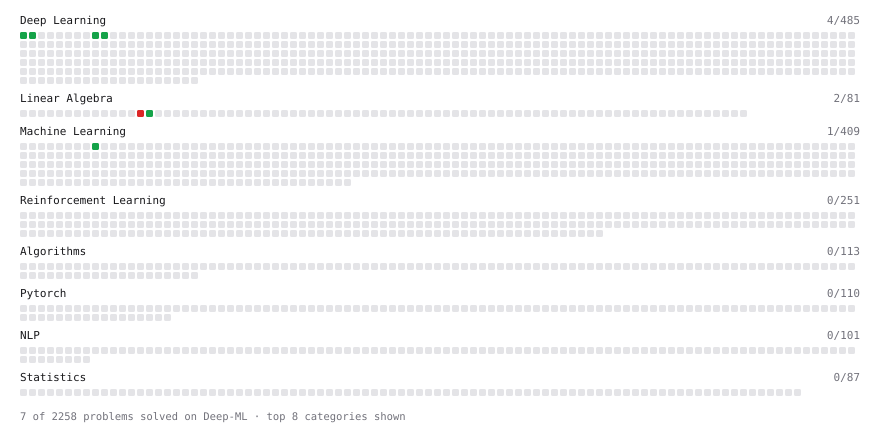

# Deep-ML

My machine learning practice from [Deep-ML](https://www.deep-ml.com). Every solution here was written by hand.

**6** solved · 6 problems · 0 labs · 0 math

[**Browse the interactive portfolio**](https://AshishRaj04.github.io/deep-ml/) to replay this filling in over time.

## Problems

| | Difficulty | Solved | |
| --- | --- | --- | --- |
| [Implement ReLU Activation Function](https://www.deep-ml.com/problems/42) | easy | 2026-11-08 | [solution](problems/0042-implement-relu-activation-function) |
| [Leaky ReLU Activation Function](https://www.deep-ml.com/problems/44) | easy | 2026-11-08 | [solution](problems/0044-leaky-relu-activation-function) |
| [Random Shuffle of Dataset](https://www.deep-ml.com/problems/29) | easy | 2026-11-13 | [solution](problems/0029-random-shuffle-of-dataset) |
| [Sigmoid Activation Function Understanding](https://www.deep-ml.com/problems/22) | easy | 2026-11-05 | [solution](problems/0022-sigmoid-activation-function-understanding) |
| [Softmax Activation Function Implementation ](https://www.deep-ml.com/problems/23) | easy | 2026-11-06 | [solution](problems/0023-softmax-activation-function-implementation) |
| [SVD of a 2x2 Matrix](https://www.deep-ml.com/problems/28) | hard | 2026-11-07 | [solution](problems/0028-svd-of-a-2x2-matrix) |

---

_This file is regenerated by Deep-ML on every push._
