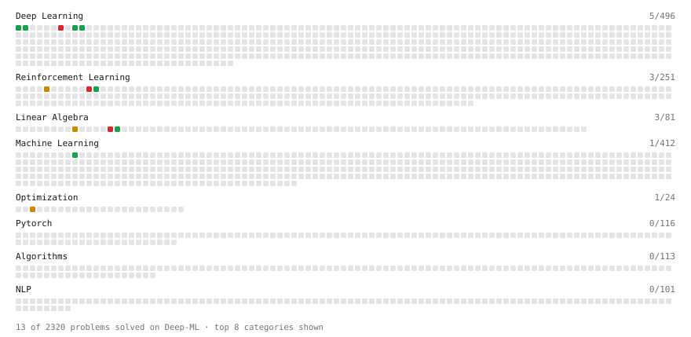

# Deep-ML

My machine learning practice from [Deep-ML](https://www.deep-ml.com). Every solution here was written by hand.

**19** solved · 18 problems · 1 labs · 0 math

[**Browse the interactive portfolio**](https://AshishRaj04.github.io/deep-ml/) to replay this filling in over time.

## Problems

| | Difficulty | Solved | |
| --- | --- | --- | --- |
| [Calculate 2x2 Matrix Inverse](https://www.deep-ml.com/problems/8) | easy | 2026-11-19 | [solution](problems/0008-calculate-2x2-matrix-inverse) |
| [Compute Discounted Return](https://www.deep-ml.com/problems/165) | easy | 2026-11-18 | [solution](problems/0165-compute-discounted-return) |
| [Convert Vector to Diagonal Matrix](https://www.deep-ml.com/problems/35) | easy | 2026-11-13 | [solution](problems/0035-convert-vector-to-diagonal-matrix) |
| [Implement ReLU Activation Function](https://www.deep-ml.com/problems/42) | easy | 2026-11-08 | [solution](problems/0042-implement-relu-activation-function) |
| [Implement the Hard Sigmoid Activation Function](https://www.deep-ml.com/problems/96) | easy | 2026-11-22 | [solution](problems/0096-implement-the-hard-sigmoid-activation-function) |
| [Leaky ReLU Activation Function](https://www.deep-ml.com/problems/44) | easy | 2026-11-08 | [solution](problems/0044-leaky-relu-activation-function) |
| [Random Shuffle of Dataset](https://www.deep-ml.com/problems/29) | easy | 2026-11-13 | [solution](problems/0029-random-shuffle-of-dataset) |
| [Scalar Multiplication of a Matrix](https://www.deep-ml.com/problems/5) | easy | 2026-11-20 | [solution](problems/0005-scalar-multiplication-of-a-matrix) |
| [Sigmoid Activation Function Understanding](https://www.deep-ml.com/problems/22) | easy | 2026-11-05 | [solution](problems/0022-sigmoid-activation-function-understanding) |
| [Softmax Activation Function Implementation ](https://www.deep-ml.com/problems/23) | easy | 2026-11-06 | [solution](problems/0023-softmax-activation-function-implementation) |
| [Bellman Expectation Equation for State-Value Function](https://www.deep-ml.com/problems/464) | medium | 2026-11-21 | [solution](problems/0464-bellman-expectation-equation-for-state-value-function) |
| [Evaluate Expected Value in a Markov Decision Process](https://www.deep-ml.com/problems/166) | medium | 2026-11-21 | [solution](problems/0166-evaluate-expected-value-in-a-markov-decision-process) |
| [Implement the Bellman Equation for Value Iteration](https://www.deep-ml.com/problems/157) | medium | 2026-11-14 | [solution](problems/0157-implement-the-bellman-equation-for-value-iteration) |
| [Matrix times Matrix ](https://www.deep-ml.com/problems/9) | medium | 2026-11-13 | [solution](problems/0009-matrix-times-matrix) |
| [Warmup + Cosine Decay Schedule](https://www.deep-ml.com/problems/196) | medium | 2026-11-17 | [solution](problems/0196-warmup-cosine-decay-schedule) |
| [Gambler's Problem: Value Iteration](https://www.deep-ml.com/problems/164) | hard | 2026-11-18 | [solution](problems/0164-gambler-s-problem-value-iteration) |
| [Implementing a Custom Dense Layer in Python](https://www.deep-ml.com/problems/40) | hard | 2026-11-18 | [solution](problems/0040-implementing-a-custom-dense-layer-in-python) |
| [SVD of a 2x2 Matrix](https://www.deep-ml.com/problems/28) | hard | 2026-11-07 | [solution](problems/0028-svd-of-a-2x2-matrix) |

## Labs

| | Difficulty | Solved | |
| --- | --- | --- | --- |
| [Design Your Own Activation Function](https://www.deep-ml.com/labs/9) | easy | 2026-11-19 | [solution](labs/0009-design-your-own-activation-function) |

---

_This file is regenerated by Deep-ML on every push._
